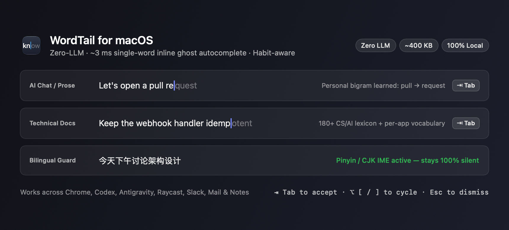
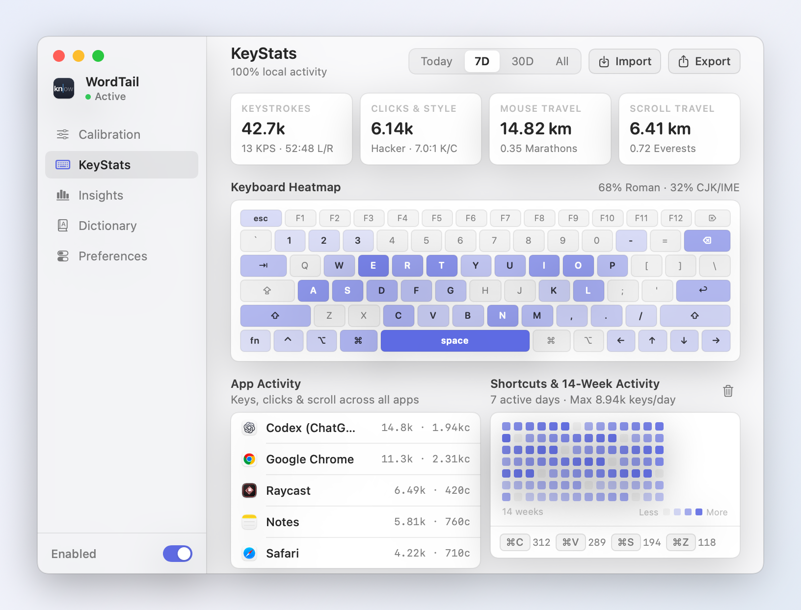
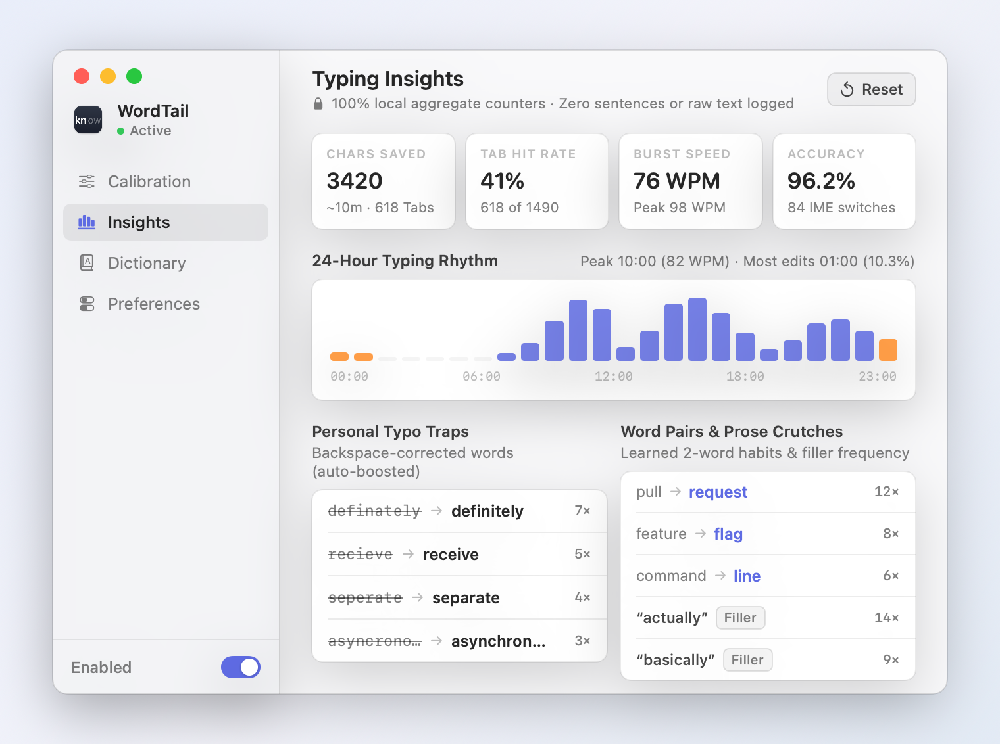
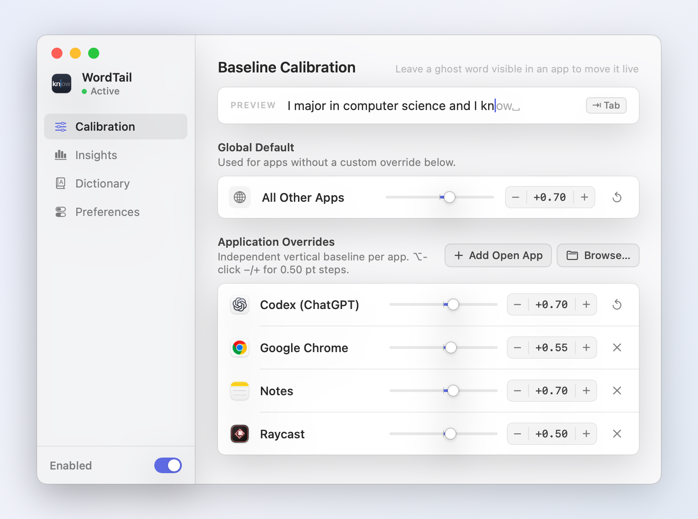

# WordTail

<p align="center">
  
</p>

<p align="center">
  <strong>Zero-LLM, habit-aware, single-word inline ghost-text autocomplete for macOS.</strong><br/>
  Sub-millisecond ranking · ~400 KB native app · 100% offline &amp; privacy-preserving.
</p>

<p align="center">
  <a href="https://github.com/Popcornnnnnnnn/word-tail/actions"></a>
  <a href="https://github.com/Popcornnnnnnnn/word-tail/releases"></a>
  <a href="LICENSE"></a>
  
</p>

---

## Why WordTail?

Most modern macOS autocomplete utilities wrap multi-gigabyte local or cloud LLMs that drain battery and hallucinate entire chatty paragraphs when all you wanted was to finish spelling `quantitative` or `idempotent`.

**WordTail** does one thing with surgical precision: it draws a subtle inline gray suffix (`kn` + gray `ow`) right at your cursor across macOS apps—**Chrome, Electron apps, Codex, Antigravity, Raycast, Slack, Mail, Notes, and WeChat**—and completes **only the current English word** when you press `Tab`.

- **Zero LLM, ~3 ms latency:** Combines macOS's grammar-aware `NSSpellChecker`, a curated **180+ CS/AI/quant lexicon**, **personal 2-word bigrams**, **per-app vocabulary**, and **typo-trap rescue**.
- **Built for bilingual & technical typists:** Stays **100% silent** whenever you switch to a non-Roman input method (Chinese Pinyin, Rime, Doubao, Japanese, Korean), focus a password field (`SecureEventInput` / `AXSecureTextField`), or edit code files inside IDEs and terminals.
- **Built-in KeyStats + Linguistic Insights (100% local, zero telemetry):** Includes a complete hardware & habit studio—daily/7D/30D/all-time keystrokes, peak KPS/CPS, Left/Right hand balance, Roman vs CJK ratio, mouse travel (`Marathons`), scroll distance (`Everests`), a 65-key MacBook ANSI heatmap, 14-week activity calendar, per-app breakdowns, top shortcuts, saved keystrokes, burst WPM, and personal typo traps—plus JSON export & `KeyStats` backup import.

---

## Screenshots

### Built-In KeyStats & Interactive Keyboard Heatmap
Tracks keystrokes, clicks, mouse & scroll distance, peak KPS, left/right hand balance, Roman vs CJK input share, top shortcuts (`⌘C`, `⌘V`, `⌘S`), a 14-week contribution grid, and per-application totals via a zero-latency `.listenOnly` passive tap—and imports existing `KeyStats` JSON backups directly.

<p align="center">
  
</p>

### Typing Insights & Habit Learning
WordTail learns your 2-word collocations (`pull → request`, `feature → flag`), weights vocabulary per app (`implementation` in Codex vs `important` in Mail), and automatically boosts words you frequently mistype and backspace (`definately → definitely`).

<p align="center">
  
</p>

### Sub-Retina-Pixel Baseline Calibration
Different macOS toolkits (Cocoa `NSTextView`, Chromium `contenteditable`, Electron, floating `NSPanel` launchers like Raycast) report slightly different caret bounds. WordTail uses CoreText + `CGImage` sub-pixel interpolation (`0.05 pt` steps) with live 60 fps preview so gray ghost text sits flush on every app's baseline.

<p align="center">
  
</p>

---

## Keyboard Shortcuts

| Shortcut | Action |
| --- | --- |
| `Tab` | Accept visible word/phrase completion or inline typo fix (`→ word`) |
| `⌥ →` | Accept **1 word** of a multi-word phrase completion (`as `, leaving `I'm concerned`) |
| `Space` | Auto-correct contractions/typos (`im` → `I'm`, `teh` → `the`) & capitalize sentence starts |
| `⌫` (after `Space`) | Revert an auto-correction immediately (no re-correct loop; 2× mutes trigger) |
| `⌥ ]` / `⌥ [` | Cycle next / previous single-word candidate (top 5 matches) |
| `Esc` | Dismiss visible ghost completion |
| `⌃ ⌥ W` | Toggle WordTail Active / Paused globally |
| `⌘ ,` | Open WordTail Settings |
| `⌘ W` | Close window (keeps WordTail autocomplete active in background) |
| `⌘ Q` | Quit WordTail |

---

## Key Architecture & Privacy Design

1. **Universal Caret Engine (`AXUIElement` + `AXTextMarker`):**
   - Reads caret coordinates via standard AppKit character ranges (`AXSelectedTextRange` / `AXBoundsForRange`) and WebKit/Chromium/Electron rich `contenteditable` markers (`AXSelectedTextMarkerRange` / `AXBoundsForTextMarkerRange`).
   - Resolves non-activating floating panels (like **Raycast** and **Spotlight**) by inspecting the Accessibility-focused UI element's owning bundle rather than relying solely on `NSWorkspace.frontmostApplication`.
   - Automatically skips Monaco code-editor tabs inside hybrid Electron apps so `Tab` keeps indenting/completing code while AI chat panels still get prose completion.
   - **Non-Overlapping Mid-Sentence Mode:** Renders pure inline gray text at the end of a line, and automatically lifts a compact pill just above the cursor whenever text follows on the same line so existing words are never covered.
2. **Habit-Aware Contextual Ranking & Bidirectionally Learnable Auto-Correct (`< 1 ms`, Zero Network):**
   - **Pinned Custom Words & Shorthand** → **Personal Bigrams (`prevWord → word`)** → **Per-App Vocabulary (`bundleID → word`)** → **Typo-Trap Auto-Rescue** → **Accepted Word Frequency** → **macOS Grammar Completion** → **CS/AI Lexicon**.
   - **Learnable Patterns:** Built-in contractions (`im` → `I'm`, `dont` → `don't`, `alot` → `a lot`, sentence-start `lets` → `Let's`), sentence-start & standalone-`"I"` capitalization (skipping CLI/dev commands like `git`, `kubectl`, `macOS`), positive graduation from your own repairs (`2×`), and automatic muting when undone twice with `⌫`.
   - **Conservative Phrase Mode (`< 1 ms`, zero LLM):** Suggests high-certainty English idioms after 2–3 anchor words (`"as far "` → `as I'm concerned` / `as I know`, `"on the other "` → `hand`) and personal phrases you repeat `3×+` with `>= 50%` consistency (keeping one-off sequences in RAM only so unique sentences never touch disk). `Tab` accepts the full phrase; `⌥ →` accepts one word at a time.
3. **Strict Privacy Boundary:**
   - Zero network calls, zero telemetry, zero raw sentence storage.
   - Passive habit counters (`word_bigrams.json`, `app_vocabulary.json`, `typing_insights.json`) accept **only** dictionary/lexicon-verified single English words and aggregate hourly counts—and can be disabled or cleared in one click.

---

## Install

### Option A: Download Prebuilt Release
Download the latest `WordTail-*-macOS.zip` from [**Releases**](https://github.com/Popcornnnnnnnn/word-tail/releases), unzip, and drag **`WordTail.app`** to `/Applications`.

### Option B: Build from Source
Requires **macOS 14.0 (Sonoma)+** and **Swift 5.10+ / Xcode Command Line Tools**:

```bash
git clone https://github.com/Popcornnnnnnnn/word-tail.git
cd word-tail

# Run unit tests
swift test

# Build release bundle and install to /Applications/WordTail.app
./scripts/build_app.sh --install
open /Applications/WordTail.app
```

On first launch, grant **Accessibility** (and **Input Monitoring** if prompted) under **System Settings → Privacy & Security**. WordTail detects permission approval automatically within 1.5 seconds—no restart required.

---

## Project Layout

```text
word-tail/
├── Sources/
│   ├── WordTailCore/
│   │   ├── WordCompleter.swift        # Contextual word/phrase completion & token guards
│   │   ├── PhrasePredictor.swift      # Conservative English idioms & self-learning n-grams
│   │   ├── ObviousTypoCorrector.swift # Learnable typo/contraction rules & sentence capitalization
│   │   ├── UserHistoryStore.swift     # Accepted words, custom dictionary, bigrams & per-app vocab
│   │   ├── TypingHabitTracker.swift   # Local WPM, accuracy, hourly rhythm & cached spellcheck
│   │   ├── KeyStatsStore.swift        # Local hardware telemetry, heatmap & JSON import/export
│   │   ├── KeyCodeMapper.swift        # 65-key MacBook ANSI physical layout & shortcut formatting
│   │   ├── TechLexicon.swift          # Indexed CS, AI, and quantitative English vocabulary
│   │   ├── InputGuard.swift           # Roman keyboard layout, SecureEventInput & IDE exclusions
│   │   └── ScreenGeometry.swift       # Quartz-to-Cocoa typography baseline math
│   └── WordTailApp/
│       ├── AXCaretContext.swift       # Windowed O(1) Accessibility & Chromium/Electron caret reader
│       ├── GhostOverlayWindow.swift   # Click-through NSPanel with inline suffix & mid-sentence pill
│       ├── TypingEngine.swift         # Non-blocking CGEventTap & tagged Unicode suffix injection
│       ├── SettingsWindowController.swift # Main window shell & NSWindowController
│       ├── Settings/                  # Modular SwiftUI views & SettingsViewModel per tab
│       └── AppDelegate.swift          # Native macOS lifecycle, Dock/menu bar & Login Item setup
├── Tests/WordTailTests/               # Unit tests for grammar, bigrams, per-app vocab & habit tracking
└── scripts/build_app.sh               # Clean-tree release builder & code-signing script
```

---

## License

Released under the [MIT License](LICENSE).
