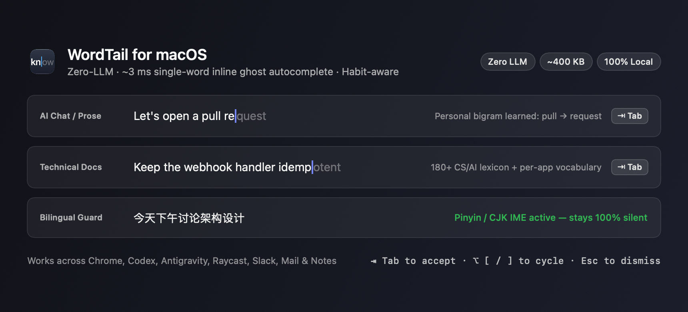
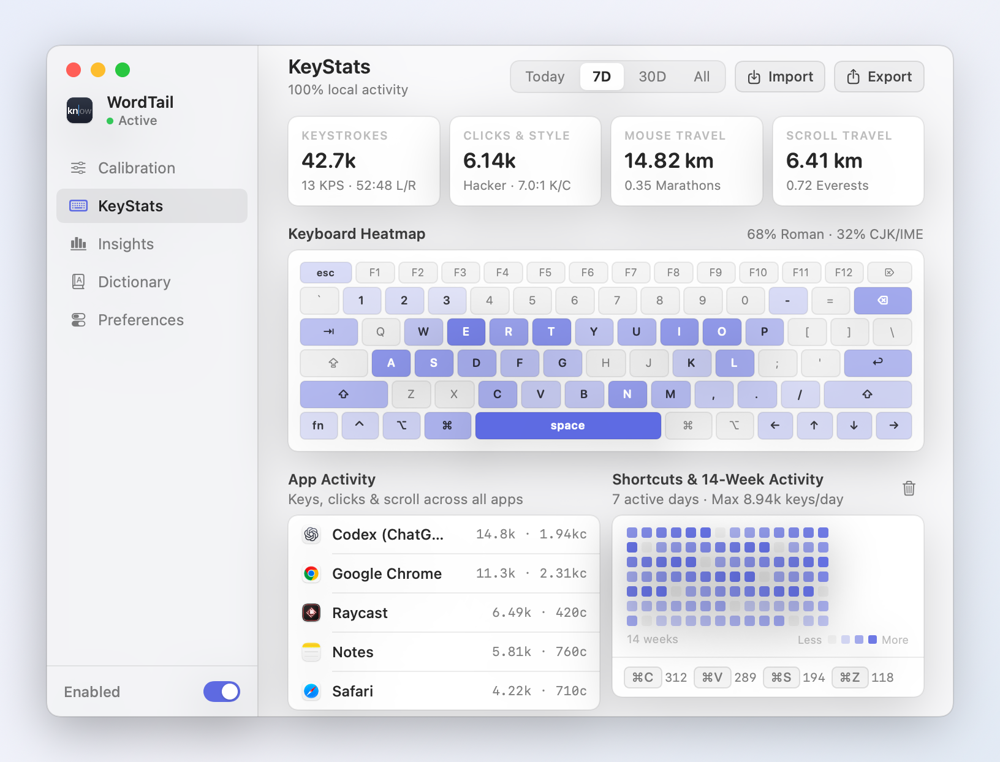
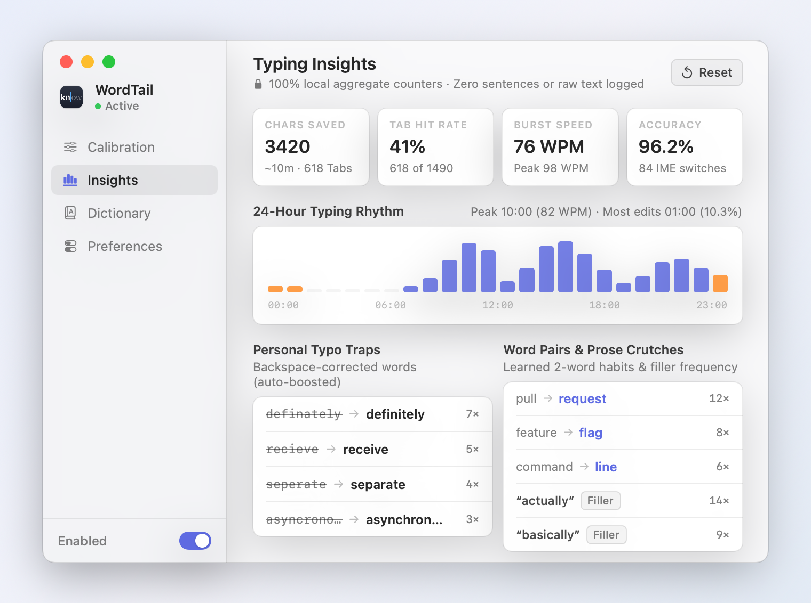
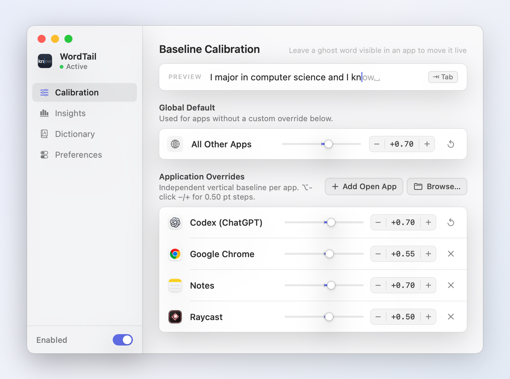

# WordTail

<p align="center">
  
</p>

<p align="center">
  <strong>零 LLM、懂习惯的 macOS 单词级行内幽灵文本自动补全工具。</strong><br/>
  亚毫秒级排序 · 约 400 KB 原生应用 · 100% 离线与隐私保护。
</p>

<p align="center">
  <a href="README.md">English</a> · <strong>简体中文</strong>
</p>

<p align="center">
  <a href="https://github.com/Popcornnnnnnnn/word-tail/actions"></a>
  <a href="https://github.com/Popcornnnnnnnn/word-tail/releases"></a>
  <a href="LICENSE"></a>
  
</p>

---

## 为什么选择 WordTail？

如今大多数 macOS 自动补全工具都包裹着数 GB 大小的本地或云端大语言模型，既耗电，又会在你只想拼完 `quantitative` 或 `idempotent` 这类单词时擅自编造一整段冗长的废话。

**WordTail** 只精准做好一件事：它在各类 macOS 应用的光标处直接绘制浅灰色行内后缀（如 `kn` + 灰色 `ow`）——支持 **Chrome、Electron 应用、Codex、Antigravity、Raycast、Slack、邮件、备忘录和微信**——并在你按下 `Tab` 时**只补全当前英文单词**。

- **零 LLM，约 3 ms 延迟：** 结合 macOS 语法感知的 `NSSpellChecker`、精选 **180+ 计算机/AI/量化词库**、**个人二元词组（bigram）**、**分应用词汇表**以及**易错词自动救援**。
- **专为双语与技术写作者打造：** 一旦切换到非拉丁输入法（中文拼音、鼠须管 Rime、豆包输入法、日文、韩文）、光标停留在密码框（`SecureEventInput` / `AXSecureTextField`），或在 IDE 与终端中编辑代码文件，WordTail 会保持 **100% 静默**。
- **内置 KeyStats 与输入洞察（100% 本地，零遥测）：** 提供完整的硬件与输入习惯工作台——今日/7 天/30 天/累计击键数、峰值 KPS/CPS、左右手平衡、拉丁与中日韩输入占比、鼠标移动距离（换算马拉松里程）、滚轮距离（换算珠峰高度）、65 键 MacBook ANSI 物理键盘热力图、14 周活跃日历、分应用统计、高频快捷键、节省击键数、爆发 WPM 与个人易错词陷阱——还支持 JSON 导出与 `KeyStats` 备份导入。
- **无冲突多设备同步与签名一键更新：** 可选通过 **iCloud Drive** 或任意共享文件夹（Dropbox、Syncthing），利用按设备分片的 CRDT 机制在多台 Mac 间同步自定义词典、简写规则、习得短语、输入洞察与 KeyStats——同时将各显示器的基线校准保留在本地。后台更新检查会校验 Apple `Developer ID` 代码签名，并一键更新 `/Applications/WordTail.app`。

---

## 界面截图

### 内置 KeyStats 与交互式键盘热力图
通过零延迟的 `.listenOnly` 被动事件监听追踪击键、点击、鼠标与滚轮距离、峰值 KPS、左右手平衡、拉丁与中日韩输入占比、高频快捷键（`⌘C`、`⌘V`、`⌘S`）、14 周贡献网格及分应用统计——并支持直接导入现有的 `KeyStats` JSON 备份。

<p align="center">
  
</p>

### 输入洞察与习惯学习
WordTail 会学习你的二元词搭配（`pull → request`、`feature → flag`），按应用调整词汇权重（在 Codex 中优先 `implementation`，在邮件中优先 `important`），并自动提升你经常打错并退格修正的单词权重（`definately → definitely`）。

<p align="center">
  
</p>

### 亚视网膜像素级基线校准
不同的 macOS 界面框架（Cocoa `NSTextView`、Chromium `contenteditable`、Electron、以及 Raycast 这类浮动 `NSPanel` 启动器）上报的光标边界略有差异。WordTail 采用 CoreText + `CGImage` 亚像素插值（`0.05 pt` 步进）与 60 fps 实时预览，让灰色幽灵文本稳稳贴合每款应用的基线。

<p align="center">
  
</p>

---

## 键盘快捷键

| 快捷键 | 操作 |
| --- | --- |
| `Tab` | 接受当前显示的单词/短语补全或行内拼写修正（`→ word`） |
| `⌥ →` | 逐词接受多词短语补全中的 **1 个词**（接受 `as `，保留 `I'm concerned`） |
| `Space` | 自动纠正常见缩写/笔误（`im` → `I'm`、`teh` → `the`）并自动将句首字母大写 |
| `⌫`（紧跟 `Space` 后） | 立即撤回自动纠错（不会陷入重复纠错循环；连续撤回 2 次将静默该触发词） |
| `⌥ ]` / `⌥ [` | 切换下一个 / 上一个单词候选（前 5 个匹配项） |
| `Esc` | 隐藏当前显示的幽灵补全 |
| `⌃ ⌥ W` | 全局切换 WordTail 启用 / 暂停 |
| `⌘ ,` | 打开 WordTail 设置 |
| `⌘ W` | 关闭窗口（WordTail 补全仍在后台保持运行） |
| `⌘ Q` | 退出 WordTail |

---

## 核心架构与隐私设计

1. **通用光标引擎（`AXUIElement` + `AXTextMarker`）：**
   - 通过标准 AppKit 字符范围（`AXSelectedTextRange` / `AXBoundsForRange`）与 WebKit/Chromium/Electron 富文本 `contenteditable` 标记（`AXSelectedTextMarkerRange` / `AXBoundsForTextMarkerRange`）读取光标坐标。
   - 通过检查辅助功能当前聚焦 UI 元素的所属 Bundle，而非仅依赖 `NSWorkspace.frontmostApplication`，精准识别非激活态浮动面板（如 **Raycast** 和 **聚焦搜索**）。
   - 自动跳过混合架构 Electron 应用中的 Monaco 代码编辑器标签页，使 `Tab` 继续用于代码缩进/补全，而 AI 对话面板依然保留英文写作补全。
   - **行中防遮挡模式：** 在行尾渲染纯正的行内灰色文字；当同一行光标右侧还有后续文字时，自动在光标上方升起紧凑气泡，绝不遮挡已有内容。
2. **习惯感知上下文排序与双向可学习自动纠错（`< 1 ms`，零联网）：**
   - **固定自定义词与简写** → **个人二元词组（`prevWord → word`）** → **分应用词汇（`bundleID → word`）** → **易错词自动救援** → **已采纳词频** → **macOS 语法补全** → **CS/AI 词库**。
   - **可学习模式：** 内置缩写纠错（`im` → `I'm`、`dont` → `don't`、`alot` → `a lot`、句首 `lets` → `Let's`）、句首与独立 `"I"` 大写（自动跳过 `git`、`kubectl`、`macOS` 等 CLI/开发词）、从你的手动修改中学习升级（`2×`），以及在被 `⌫` 撤回两次后自动静默。
   - **保守短语模式（`< 1 ms`，零 LLM）：** 在输入 2–3 个锚点词后提示高置信度英文惯用语（`"as far "` → `as I'm concerned` / `as I know`，`"on the other "` → `hand`），以及你以 `>= 50%` 一致性重复使用 `3×+` 的个人短语（单次出现的序列仅保留在内存中，独特句子绝不落盘）。`Tab` 接受完整短语；`⌥ →` 每次接受一个词。
3. **严格隐私边界：**
   - 零遥测、零统计上报、零原始句子存储。除非你主动开启多设备同步（使用你自己的 iCloud Drive 或指定文件夹），否则输入数据绝不会离开你的 Mac；可选的 GitHub Release 更新检查不发送任何用户数据，且可随时关闭。
   - 被动习惯计数器（`word_bigrams.json`、`app_vocabulary.json`、`typing_insights.json`）**仅**接收经词典/词库校验的单个英文单词与按小时聚合的计数——并且支持一键禁用或清空。

---

## 安装方式

### 方式 A：Homebrew Cask（推荐）
```bash
brew install --cask Popcornnnnnnnn/tap/wordtail
```
后续可通过 Homebrew 升级（或使用 WordTail 内置的一键自动更新器）：
```bash
brew upgrade --cask Popcornnnnnnnn/tap/wordtail
```

### 方式 B：下载预编译发布版
从 [**Releases**](https://github.com/Popcornnnnnnnn/word-tail/releases) 下载经过 Developer ID 签名并由 Apple 公证的 `WordTail-*-macOS.zip`，解压后将 **`WordTail.app`** 拖入 `/Applications`。

### 方式 C：从源码构建
需要 **macOS 14.0 (Sonoma)+** 与 **Swift 5.10+ / Xcode Command Line Tools**：

```bash
git clone https://github.com/Popcornnnnnnnn/word-tail.git
cd word-tail

# 运行单元测试
swift test

# 构建 Release 包并安装到 /Applications/WordTail.app
./scripts/build_app.sh --install
open /Applications/WordTail.app
```

首次启动时，请在 **系统设置 → 隐私与安全性** 中授予 **辅助功能**（以及如有提示的 **输入监控**）权限。WordTail 会在 1.5 秒内自动检测到权限授权——无需重启应用。

---

## 项目结构

```text
word-tail/
├── Sources/
│   ├── WordTailCore/
│   │   ├── WordCompleter.swift        # 上下文单词/短语补全与分词护栏
│   │   ├── PhrasePredictor.swift      # 保守英文惯用语与自学习 n-gram
│   │   ├── ObviousTypoCorrector.swift # 可学习的拼写/缩写纠错与句首大写
│   │   ├── UserHistoryStore.swift     # 已采纳词、自定义词典、二元词组与分应用词汇
│   │   ├── TypingHabitTracker.swift   # 本地 WPM、准确率、小时节律与拼写检查缓存
│   │   ├── KeyStatsStore.swift        # 本地硬件遥测、热力图与 JSON 导入导出
│   │   ├── SyncEngine.swift           # 无冲突按设备 CRDT 分片同步（iCloud Drive / 文件夹）
│   │   ├── KeyCodeMapper.swift        # 65 键 MacBook ANSI 物理布局与快捷键格式化
│   │   ├── TechLexicon.swift          # 已索引的 CS、AI 与量化英文词库
│   │   ├── InputGuard.swift           # 拉丁键盘布局、SecureEventInput 与 IDE 排除判断
│   │   └── ScreenGeometry.swift       # Quartz 到 Cocoa 的排版基线几何换算
│   └── WordTailApp/
│       ├── AXCaretContext.swift       # 窗口化 O(1) 辅助功能与 Chromium/Electron 光标读取
│       ├── GhostOverlayWindow.swift   # 鼠标穿透 NSPanel，承载行内后缀与行中气泡
│       ├── TypingEngine.swift         # 非阻塞 CGEventTap 与带标记 Unicode 后缀注入
│       ├── AutoUpdateManager.swift    # 已签名 GitHub Release 检查、校验与原子更新器
│       ├── SettingsWindowController.swift # 主窗口外壳与 NSWindowController
│       ├── Settings/                  # 按标签页拆分的模块化 SwiftUI 视图与 SettingsViewModel
│       └── AppDelegate.swift          # 原生 macOS 生命周期、程序坞/菜单栏与登录项配置
├── Tests/WordTailTests/               # 覆盖语法、二元词组、分应用词汇与习惯追踪的单元测试
└── scripts/build_app.sh               # 干净工作树 Release 构建与代码签名脚本
```

---

## Studio 工具箱（全部免费内置）

`v0.8.3` 中的每一项功能——行内 Tab 补全、多词短语预测、行内易错词救援、自适应自动纠错与句首大写、KeyStats、按设备 iCloud/文件夹同步、基线校准——连同全新的 **Studio** 工具均保持 **MIT 开源且 100% 免费**：

- **领域词库包：** 内置 6 个专业词库（AI/ML 与量化、系统与 DevOps、生物医药、法律/金融、产品/设计、学术研究），并支持便携的 `.wordtailpack` JSON 导入/导出。
- **片段工作室与宏：** 基于触发词展开（`;date`、`;iso`、`;time`、`;meet`、`;pr`、`;clip`），支持 `{date}`、`{date:...}`、`{time}`、`{iso}`、`{weekday}`、`{clipboard}` 与 `{cursor}` 光标定位。
- **分应用写作档案与中英混排：** 为不同应用自动或按预设切换规则（`日常聊天`、`正式文档`、`工程沟通`），并提供中英混排补全边界识别与采纳时自动盘古之白加空格。
- **输入年度总结与导出：** 离线生成 `3:4` 与 `16:9` 浅色/深色 PNG 海报、每日与分应用 CSV 表格及 Markdown 摘要。

---

## 许可证

基于 [MIT 许可证](LICENSE) 发布。
